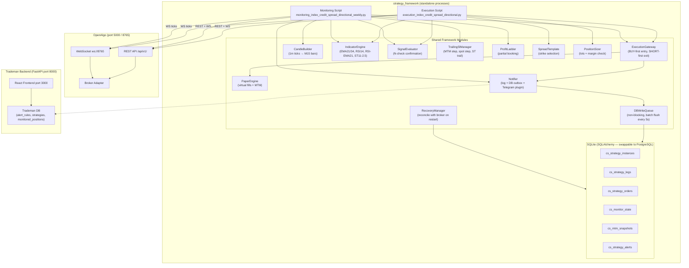
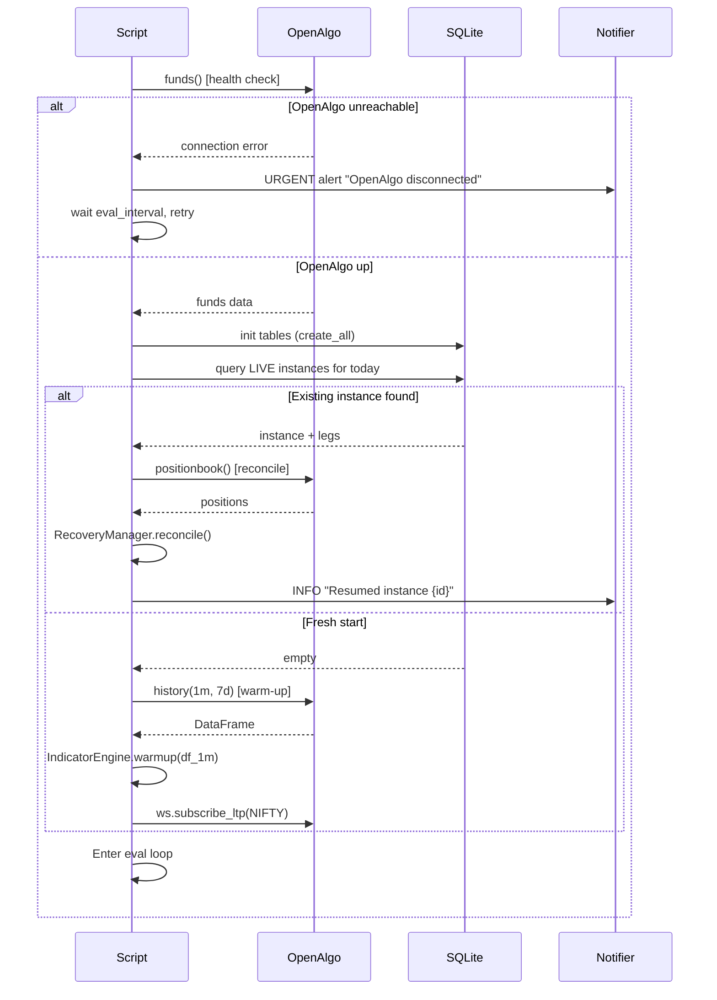
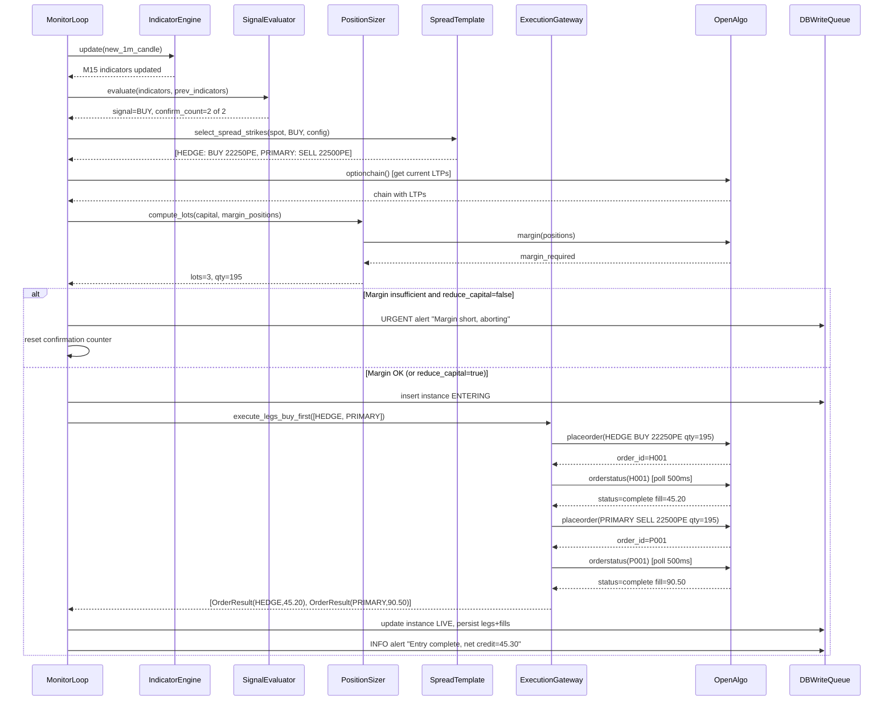
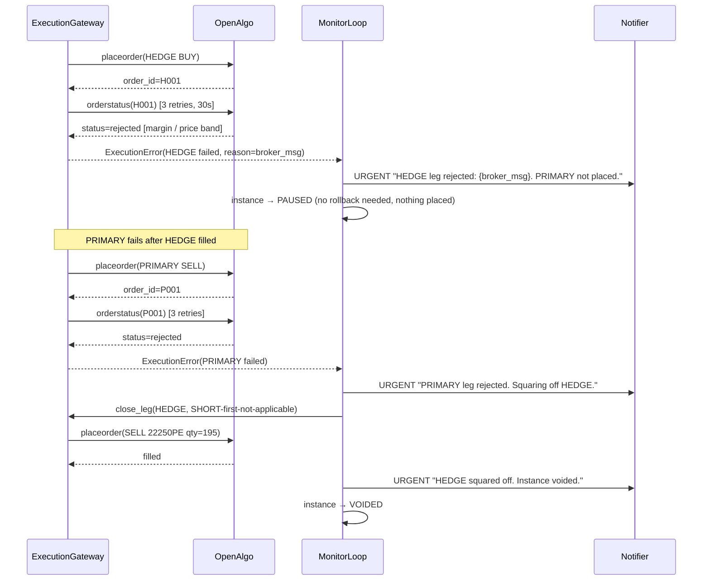
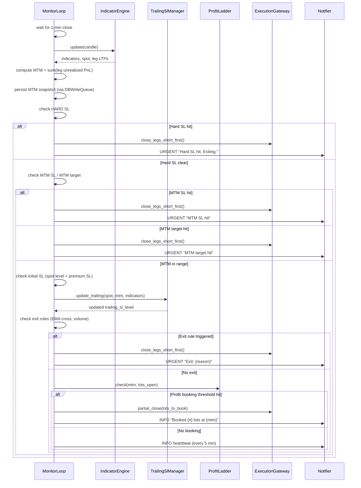
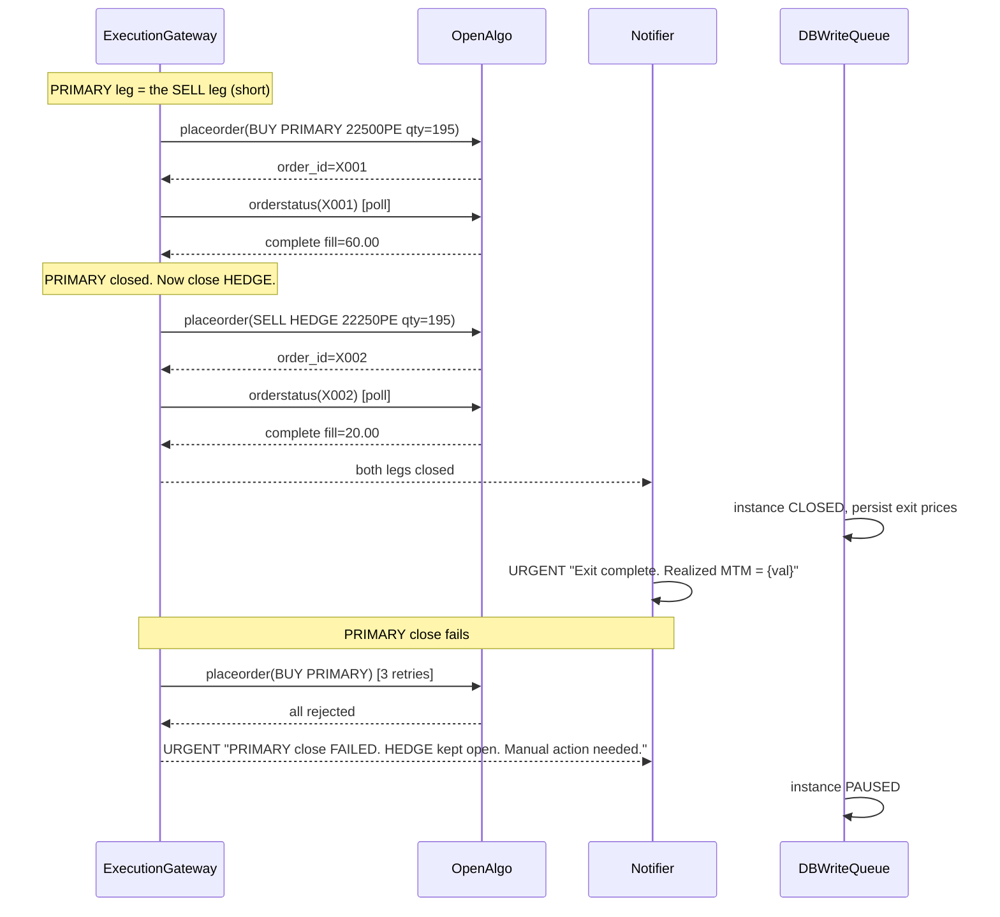
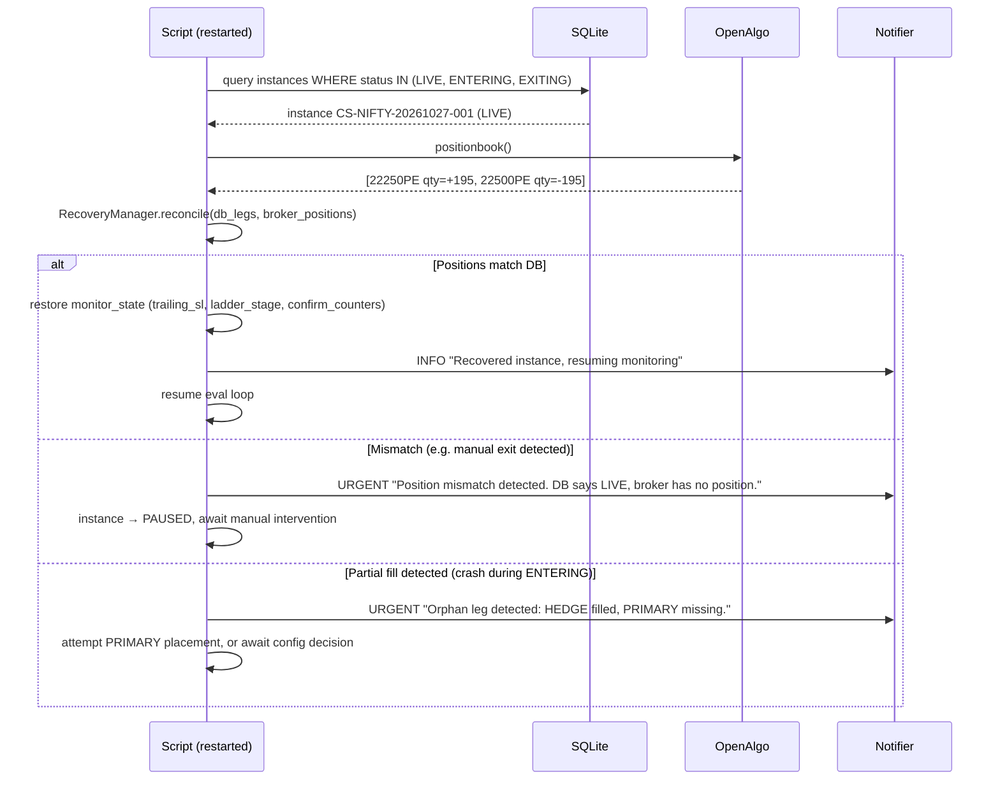
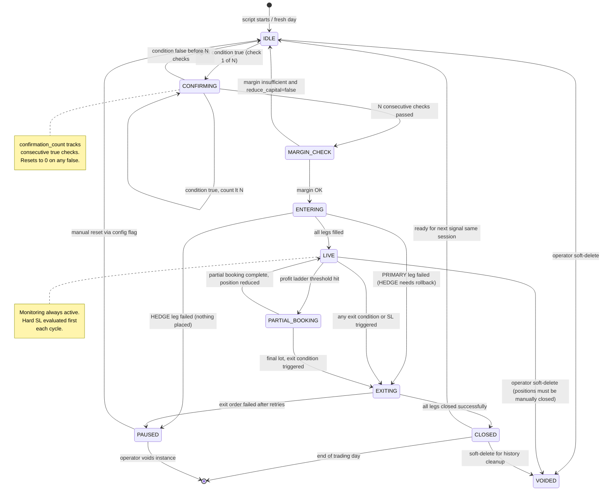

# Credit Spread Strategy — Design Document

**Version:** 1.0 — Phase 1
**Date:** 2026-10-25
**Scope:** `Strategy-Execution-Index-Credit-Spread-Directional` + `Monitoring-Index-Credit-Spread-Directional-WEEKLY`

---

## Table of Contents

1. [Requirement Summary](#1-requirement-summary)
2. [Architecture Overview](#2-architecture-overview)
3. [Component List](#3-component-list)
4. [Sequence Diagrams](#4-sequence-diagrams)
5. [State Machine](#5-state-machine)
6. [Database Schema](#6-database-schema)
7. [Config Schema + Example YAML](#7-config-schema--example-yaml)
8. [Use Cases and Test Matrix](#8-use-cases-and-test-matrix)
9. [Open Questions and Fixed Assumptions](#9-open-questions-and-fixed-assumptions)

---

## 1. Requirement Summary

### 1.1 What This Builds

Two standalone Python scripts that trade NIFTY weekly options credit spreads:

- **Execution script** (`execution_index_credit_spread_directional.py`): Watches for directional signals on NIFTY M15 chart, selects strikes, checks margin, places orders via OpenAlgo, and hands off the live position to the monitoring script.
- **Monitoring script** (`monitoring_index_credit_spread_directional_weekly.py`): Runs independently (or attached to the execution script), picks up live/paper instances from the DB, evaluates stoploss/trailing/exit conditions every eval interval, and sends alerts or places exit orders depending on its execution rights.

Both scripts run standalone or hosted inside OpenAlgo's `/python` strategy runner — same code, no changes needed.

---

### 1.2 Strategy Logic Summary

**Instrument:** NIFTY weekly options on NFO
**Expiry:** Current weekly Thursday expiry (resolved from OpenAlgo API, never hardcoded)
**Lot size:** Fetched from option chain API on every startup
**Eval interval:** Default 1-minute candle close
**Higher timeframe:** M15 (15-minute candle, forming bar updated every 1-min close)

**BUY signal → Sell PUT credit spread (bullish bias)**

| Rule | Condition |
|---|---|
| Base condition | M15 close > M15 EMA(21) |
| Entry (all must be true) | Base AND M15 close crosses above M15 Supertrend(11, 2.5) AND M15 RSI(14) > EMA(21) of RSI(14) |
| Confirmation | All entry conditions true on N=2 consecutive 1-min closes (configurable) |
| Initial SL | Previous-to-entry M15 candle low − 10 pts (spot level), OR short-leg premium rises ≥ 20% from entry |
| Exit (any one) | M15 close crosses below EMA(21) OR M15 close crosses below Supertrend OR MTM ≤ SL MTM OR MTM ≥ target MTM OR spot crosses below trailing SL OR M15 volume > 3× EMA(21) of volume |
| Trailing SL (optional) | MTM step-trail, spot step-trail, or Supertrend-trail |
| Hard SL (mandatory) | MTM loss ≥ configured hard-stop OR M15 close crosses below EMA(34) |

**SELL signal → Sell CALL credit spread (bearish bias)** — mirror of BUY (reverse directions, use highs+10).

**Spread template (BUY signal example, spot 22500):**

| Action | Strike | Type | Role |
|---|---|---|---|
| BUY | 22250 | PE | HEDGE |
| SELL | 22500 | PE | PRIMARY |

SELL signal: BUY 22750 CE (HEDGE), SELL 22500 CE (PRIMARY).

---

### 1.3 Four Execution Modes

| Mode | Entry orders | Exit orders | Monitoring |
|---|---|---|---|
| `MONITOR_ONLY` (default) | Paper | Paper | Always on |
| `ENTRY_EXEC_MONITOR` | Real | Paper (alerts only) | Always on |
| `EXIT_EXEC_MONITOR` | Paper | Real | Always on |
| `FULL_EXEC` | Real | Real | Always on |

Monitoring is always on. Execution is opt-in. Default is `MONITOR_ONLY`.

---

### 1.4 Order Execution Protocol

**Entry (hedge-first for margin benefit):**
1. Place HEDGE (BUY) leg as marketable limit
2. Poll fills every 500ms, timeout 30s; if not filled → modify to current LTP; retry up to 3×
3. If HEDGE fails after retries → **abort, URGENT alert, do not place PRIMARY leg**
4. After HEDGE fills → place PRIMARY (SELL) leg
5. If PRIMARY fails → **URGENT alert, immediately square off the filled HEDGE leg**
6. Both filled → instance `LIVE`; persist to DB

**Exit (PRIMARY/short leg first — to protect margin):**
1. Buy back PRIMARY (SELL) leg first
2. If PRIMARY close fails → **URGENT alert, do not close HEDGE** (keeps margin protection)
3. After PRIMARY closes → sell HEDGE (BUY) leg

**Idempotency:** order tag = `{instance_id}_{leg_role}_{action}` — deterministic, prevents double-placement on restart.

---

### 1.5 OpenAlgo Connectivity Assumption

OpenAlgo is the **sole data and order source**. If OpenAlgo is unreachable:
- Trademan stays up; UI shows `DISCONNECTED` indicator (already exists)
- Strategy scripts pause their evaluation loop (no orders, no decisions)
- Scripts emit `URGENT` alert and retry health check every cycle
- When OpenAlgo reconnects → auto-resume from persisted state, no restart needed

---

## 2. Architecture Overview



---

## 3. Component List

### 3.1 New Framework Modules (to be built)

| Module | Path | Responsibility | Reuses |
|---|---|---|---|
| `IndicatorEngine` | `framework/indicator_engine.py` | Warm-up from history + incremental per-1m-close updates for EMA21, EMA34, RSI14, EMA21(RSI), Supertrend(11,2.5), VolumeEMA21 on M15 frame | `calculators.py` vendored copy |
| `CandleBuilder` | `framework/candle_builder.py` | Assembles 1-min WS ticks into OHLCV candles; on every candle close fires indicator update | — |
| `SignalEvaluator` | `framework/signal.py` | `ConfirmationCounter` (N consecutive checks), `crossover_above/below()`, condition tree evaluation against indicator state | — |
| `TrailingSlManager` | `framework/trailing.py` | MTM step-trail, spot step-trail (ratchet only), Supertrend-trail; never moves SL against position | — |
| `ProfitLadder` | `framework/trailing.py` | Configurable partial-exit thresholds; tracks stage; triggers `PARTIAL_BOOKING` | — |
| `SpreadTemplate` | `framework/spread_template.py` | `select_spread_strikes(spot, side, short_offset, hedge_width, expiry, strike_interval)` → `[OptionLeg, OptionLeg]`; tags each leg with role `PRIMARY` / `HEDGE` | `OptionLeg` model |
| `ExpiryUtils` | `framework/expiry_utils.py` | `select_expiry()` (DTE logic from OpenAlgo expiry list); `fetch_lot_size()`; `fetch_strike_interval()` | `OpenAlgoClient` |
| `PositionSizer` | `framework/sizing.py` | `compute_lots(capital, capital_per_lot, margin_required, reduce_if_short)` | — |
| `MarketUtils` | `framework/market_utils.py` | `is_trading_window()`, `is_holiday()`, `get_freeze_qty(symbol)` | `OpenAlgoClient` |
| `Notifier` | `framework/notifier.py` | `Notifier` ABC; `LogNotifier` (always on); `TelegramNotifier` (plugin); DB outbox via `DBWriteQueue` | `logger.py` |
| `DBWriteQueue` | `framework/db_writer.py` | Non-blocking `put(event)`; background thread flushes batch to SQLite every N seconds (default 5s); graceful drain on shutdown | SQLAlchemy |
| `indicators.py` | `framework/indicators.py` | Vendored copy of `backend/services/indicators/calculators.py` + Supertrend incremental math | numpy only |
| `VolumeMonitor` | `framework/volume_monitor.py` | Fetches volume from NIFTY_FUT or PRIMARY leg LTP stream; computes vol > N × EMA(M) | `IndicatorEngine` |
| `CreditSpreadDB` | `framework/credit_spread_db.py` | SQLAlchemy models + Alembic-compatible `create_all`; single source of truth for all tables | SQLAlchemy |
| `RecoveryManager` (extended) | Extends existing | Credit spread 2-leg reconciliation; detect manual exits; detect orphan legs | Existing `RecoveryManager` |

### 3.2 Modules Reused As-Is

| Module | Path | Notes |
|---|---|---|
| `OpenAlgoClient` | `framework/openalgo_client.py` | Adds: `modify_order()`, `get_lot_size()`, `get_strike_interval()`, `ping()` — additive only |
| `Config` | `framework/config_loader.py` | Subclass `CreditSpreadConfig` with new required keys |
| `ExecutionGateway` | `framework/execution_gateway.py` | Adds: `close_legs_short_first()`, `execute_mode` awareness — additive only |
| `PaperEngine` | `paper/paper_engine.py` | Adds: bid/ask fill price option |
| `MonitoringEngine` | `framework/monitor.py` | Used as-is; interval and strategy injected from outside |
| `BaseStrategy` | `base/base_strategy.py` | Credit spread subclasses this |
| `StrategyState` | `models/strategy_state.py` | Subclass `CreditSpreadState` with extra fields |
| `OptionLeg` | `models/option_leg.py` | Extend `LegRole` enum to add `PRIMARY`, `HEDGE` |
| `logger.py` | `utils/logger.py` | As-is; per-instance log file added |
| `helper.py` | `utils/helper.py` | As-is |

### 3.3 Execution Script Responsibilities

1. Read config YAML; validate all keys
2. Init DB (create tables if not exist)
3. Health check OpenAlgo (ping via `funds()`); if down → alert + wait (do not exit)
4. Check trading window + market holiday
5. Recovery scan: any live instance in DB for today? Resume it
6. Wait for eval interval tick (1-min close)
7. Fetch 1m history (warm-up pass) → build M15 candles → seed indicators
8. Subscribe WS for spot + legs (after strike selection)
9. On each tick: update candle builder → on candle close → update indicators → run `SignalEvaluator`
10. Signal confirmed (N checks) → `PositionSizer` → margin check → strike selection → order placement → persist instance
11. Attach monitoring script configuration
12. Hand off to monitoring loop; execution script may stay alive or exit cleanly

### 3.4 Monitoring Script Responsibilities

1. Read config YAML
2. Health check OpenAlgo
3. Query DB for all `LIVE` or `PAPER` instances attached to this monitor
4. Recovery: reconcile DB legs vs broker positions; alert on mismatch
5. Load indicator state; warm-up from history
6. Subscribe WS for all leg symbols
7. On each eval cycle: fetch quotes → update MTM → evaluate priority order:
   - **Hard SL** → exit immediately
   - **MTM SL / target** → exit or book profit
   - **Initial SL** (spot level + premium SL) → exit
   - **Trailing SL update** → ratchet if favourable
   - **Exit rules** (indicator cross, volume) → exit
   - **Profit booking ladder** → partial exit
   - **Proximity alerts** → INFO alerts
8. If has execution rights → call `ExecutionGateway`; else → alert only
9. On instance close → mark `CLOSED` in DB; continue loop for remaining instances

---

## 4. Sequence Diagrams

### 4.1 Startup and Health Check



### 4.2 Signal → Margin → Order Placement (Entry)



### 4.3 Leg Failure Rollback



### 4.4 Monitoring Loop (One Cycle)



### 4.5 Exit Sequence (SHORT-first)



### 4.6 Crash Recovery



---

## 5. State Machine



---

## 6. Database Schema

All tables prefixed `cs_` (credit spread). Engine: SQLAlchemy (SQLite default; PostgreSQL via config URL).
Write path: non-blocking `DBWriteQueue` → batch flush every 5 seconds.

### 6.1 `cs_strategy_instances`

Primary record for each trade attempt (paper or live).

```sql
CREATE TABLE cs_strategy_instances (
    id              TEXT PRIMARY KEY,          -- CS-NIFTY-20261027-001
    strategy_name   TEXT NOT NULL,             -- CREDIT_SPREAD_DIRECTIONAL
    underlying      TEXT NOT NULL,             -- NIFTY
    expiry          TEXT NOT NULL,             -- 07MAY26
    signal_side     TEXT NOT NULL,             -- BUY | SELL
    execution_mode  TEXT NOT NULL,             -- MONITOR_ONLY | ENTRY_EXEC_MONITOR | EXIT_EXEC_MONITOR | FULL_EXEC
    is_paper        INTEGER NOT NULL DEFAULT 1,
    status          TEXT NOT NULL DEFAULT 'IDLE',  -- state machine value
    lots            INTEGER NOT NULL DEFAULT 0,
    lots_open       INTEGER NOT NULL DEFAULT 0,
    signal_spot     REAL,                      -- NIFTY spot at signal time
    entry_spot      REAL,                      -- NIFTY spot at first fill
    initial_sl_spot REAL,                      -- prev M15 candle low/high ± 10
    net_credit      REAL,                      -- total premium collected
    realized_pnl    REAL DEFAULT 0.0,
    entry_time      TEXT,
    exit_time       TEXT,
    exit_reason     TEXT,
    paused_reason   TEXT,
    config_snapshot TEXT,                      -- JSON snapshot of config at entry time
    created_at      TEXT DEFAULT (datetime('now')),
    updated_at      TEXT DEFAULT (datetime('now'))
);
CREATE INDEX idx_cs_instances_status   ON cs_strategy_instances (status);
CREATE INDEX idx_cs_instances_expiry   ON cs_strategy_instances (expiry);
CREATE INDEX idx_cs_instances_created  ON cs_strategy_instances (created_at DESC);
```

### 6.2 `cs_strategy_legs`

One row per leg per instance. Supports partial exits (qty_open < qty_total).

```sql
CREATE TABLE cs_strategy_legs (
    id              TEXT PRIMARY KEY,          -- UUID
    instance_id     TEXT NOT NULL REFERENCES cs_strategy_instances(id),
    leg_role        TEXT NOT NULL,             -- PRIMARY | HEDGE
    action          TEXT NOT NULL,             -- BUY | SELL (entry action)
    symbol          TEXT NOT NULL,             -- NIFTY07MAY2622500PE
    exchange        TEXT NOT NULL,             -- NFO
    strike          REAL NOT NULL,
    option_type     TEXT NOT NULL,             -- CE | PE
    expiry          TEXT NOT NULL,
    product         TEXT NOT NULL,             -- NRML | MIS
    qty_total       INTEGER NOT NULL,
    qty_open        INTEGER NOT NULL,
    entry_price     REAL,
    exit_price      REAL,
    entry_order_id  TEXT,
    exit_order_id   TEXT,
    status          TEXT NOT NULL DEFAULT 'PENDING',  -- PENDING|OPEN|CLOSED|FAILED
    entry_time      TEXT,
    exit_time       TEXT,
    created_at      TEXT DEFAULT (datetime('now'))
);
CREATE INDEX idx_cs_legs_instance  ON cs_strategy_legs (instance_id);
CREATE INDEX idx_cs_legs_status    ON cs_strategy_legs (status);
```

### 6.3 `cs_strategy_orders`

Full audit trail of every order placed (including retries and rollbacks).

```sql
CREATE TABLE cs_strategy_orders (
    id              TEXT PRIMARY KEY,          -- UUID
    instance_id     TEXT NOT NULL REFERENCES cs_strategy_instances(id),
    leg_id          TEXT REFERENCES cs_strategy_legs(id),
    broker_order_id TEXT,                      -- from OpenAlgo
    client_tag      TEXT,                      -- deterministic idempotency tag
    symbol          TEXT NOT NULL,
    action          TEXT NOT NULL,             -- BUY | SELL
    qty_requested   INTEGER NOT NULL,
    qty_filled      INTEGER DEFAULT 0,
    price_requested REAL,
    price_filled    REAL,
    price_type      TEXT DEFAULT 'LIMIT',      -- MARKET | LIMIT
    product         TEXT,
    order_status    TEXT,                      -- complete|rejected|cancelled|timeout
    is_retry        INTEGER DEFAULT 0,
    is_rollback     INTEGER DEFAULT 0,
    broker_message  TEXT,                      -- raw broker rejection reason
    placed_at       TEXT DEFAULT (datetime('now')),
    filled_at       TEXT
);
CREATE INDEX idx_cs_orders_instance  ON cs_strategy_orders (instance_id);
CREATE INDEX idx_cs_orders_tag       ON cs_strategy_orders (client_tag);
```

### 6.4 `cs_monitor_state`

Per-instance state that must survive restarts. Written after every eval cycle.

```sql
CREATE TABLE cs_monitor_state (
    instance_id           TEXT PRIMARY KEY REFERENCES cs_strategy_instances(id),
    confirm_count         INTEGER DEFAULT 0,   -- current N-check counter
    last_candle_ts        TEXT,                -- ISO timestamp of last processed 1m candle
    trailing_sl_level     REAL,                -- current trailing SL (spot level or MTM)
    trailing_sl_type      TEXT,                -- SPOT | MTM | INDICATOR
    initial_sl_breached   INTEGER DEFAULT 0,
    profit_ladder_stage   INTEGER DEFAULT 0,   -- 0=none, 1=first booking done, etc.
    indicator_snapshot    TEXT,                -- JSON: last known EMA21/34/RSI/ST values
    last_eval_ts          TEXT,
    updated_at            TEXT DEFAULT (datetime('now'))
);
```

### 6.5 `cs_mtm_snapshots`

Time-series MTM history (every 5 minutes while LIVE).

```sql
CREATE TABLE cs_mtm_snapshots (
    id              INTEGER PRIMARY KEY AUTOINCREMENT,
    instance_id     TEXT NOT NULL REFERENCES cs_strategy_instances(id),
    ts              TEXT NOT NULL,
    spot            REAL,
    mtm             REAL NOT NULL,
    lots_open       INTEGER,
    trailing_sl     REAL,
    created_at      TEXT DEFAULT (datetime('now'))
);
CREATE INDEX idx_cs_mtm_instance_ts ON cs_mtm_snapshots (instance_id, ts DESC);
```

### 6.6 `cs_strategy_alerts`

Every alert emitted by any script (INFO and URGENT).

```sql
CREATE TABLE cs_strategy_alerts (
    id              INTEGER PRIMARY KEY AUTOINCREMENT,
    instance_id     TEXT REFERENCES cs_strategy_instances(id),
    level           TEXT NOT NULL,             -- INFO | URGENT
    code            TEXT NOT NULL,             -- SIGNAL_FIRED | SL_HIT | ORDER_PLACED | etc.
    message         TEXT NOT NULL,
    payload         TEXT,                      -- JSON extra data (spot, mtm, order_id, etc.)
    notified        INTEGER DEFAULT 0,         -- 1 = delivered to all channels
    ts              TEXT DEFAULT (datetime('now'))
);
CREATE INDEX idx_cs_alerts_instance  ON cs_strategy_alerts (instance_id);
CREATE INDEX idx_cs_alerts_level     ON cs_strategy_alerts (level);
CREATE INDEX idx_cs_alerts_ts        ON cs_strategy_alerts (ts DESC);
```

### 6.7 `cs_monitor_attachments`

Which monitoring scripts are attached to which instances, and which has execution rights.

```sql
CREATE TABLE cs_monitor_attachments (
    id              INTEGER PRIMARY KEY AUTOINCREMENT,
    instance_id     TEXT NOT NULL REFERENCES cs_strategy_instances(id),
    monitor_name    TEXT NOT NULL,             -- monitoring script identifier
    has_exec_rights INTEGER DEFAULT 0,         -- only one per instance may be 1
    is_active       INTEGER DEFAULT 1,
    attached_at     TEXT DEFAULT (datetime('now'))
);
CREATE UNIQUE INDEX idx_cs_attach_unique ON cs_monitor_attachments (instance_id, monitor_name);
```

---

## 7. Config Schema + Example YAML

### 7.1 Execution Script Config

```yaml
# =============================================================================
# execution_index_credit_spread_directional.yaml
# NIFTY Directional Credit Spread — Execution Config
# =============================================================================

# --- OpenAlgo connection (env vars override these) ---------------------------
openalgo_api_key: ""              # set via env OPENALGO_API_KEY or here
openalgo_host: "http://127.0.0.1:5000"
websocket_url: ""                 # leave blank to derive from openalgo_host

# --- Strategy identity -------------------------------------------------------
strategy_name: "CS_DIRECTIONAL"
instance_id_prefix: "CS-NIFTY"   # instance IDs: CS-NIFTY-{YYYYMMDD}-{NNN}

# --- Execution mode ----------------------------------------------------------
# MONITOR_ONLY | ENTRY_EXEC_MONITOR | EXIT_EXEC_MONITOR | FULL_EXEC
execution_mode: "MONITOR_ONLY"

# --- Instrument --------------------------------------------------------------
underlying: "NIFTY"
exchange_spot: "NSE_INDEX"
exchange_options: "NFO"
product: "NRML"                   # NRML for positional; MIS for intraday

# --- Expiry ------------------------------------------------------------------
expiry_type: "current_weekly"     # current_weekly | next_weekly | current_monthly
# DTE logic: DTE>=2 → nearest; DTE=1 and hour<13 → nearest; else → next
skip_entry_on_expiry_day: true    # no new entries on expiry Thursday

# --- Capital and sizing ------------------------------------------------------
deployed_capital: 100000
capital_per_lot: 25000            # approx margin per lot; used if margin API unavailable
allow_reduce_capital_if_margin_short: false

# --- Spread template ---------------------------------------------------------
# BUY signal (put credit spread)
put_short_offset: 0               # sell_put = ATM - put_short_offset (0 = ATM)
put_hedge_width: 250              # buy_put  = sell_put - put_hedge_width

# SELL signal (call credit spread)
call_short_offset: 0              # sell_call = ATM + call_short_offset
call_hedge_width: 250             # buy_call  = sell_call + call_hedge_width

# --- Indicator parameters ----------------------------------------------------
ema_fast_period: 21               # EMA21 on M15 close
ema_slow_period: 34               # EMA34 on M15 close (hard SL reference)
rsi_period: 14
rsi_ema_period: 21                # EMA of RSI
supertrend_period: 11
supertrend_multiplier: 2.5

# --- Signal confirmation -----------------------------------------------------
eval_interval: "1m"               # LIVE | 15s | 30s | 1m | 3m | 5m
confirm_checks: 2                 # N consecutive true checks required

# --- BUY tab (PUT credit spread) ---------------------------------------------
buy_tab:
  enabled: true
  entry_rules:
    - { indicator: "EMA21", timeframe: "M15", condition: "close_above" }
    - { indicator: "SUPERTREND", timeframe: "M15", condition: "cross_above" }
    - { indicator: "RSI14", timeframe: "M15", condition: "above_rsi_ema21" }

  initial_stoploss:
    spot_level:
      offset: -10                 # prev M15 candle low − 10 pts
      confirm_checks: 2           # consecutive 1-min closes below SL spot
    premium_sl:
      short_leg_rise_pct: 20      # short-leg premium rises ≥ 20% from entry

  exit_rules:
    - { type: "indicator", indicator: "EMA21",      condition: "cross_below", confirm: 2 }
    - { type: "indicator", indicator: "SUPERTREND", condition: "cross_below", confirm: 2 }
    - { type: "mtm",       condition: "lte",         value_key: "mtm_stoploss_per_lot" }
    - { type: "mtm",       condition: "gte",         value_key: "mtm_target_per_lot" }
    - { type: "volume",    sources: ["NIFTY_FUT", "PRIMARY_LEG"],
                           combine: "ANY",
                           multiplier: 3.0, ema_period: 21, confirm: 2 }

  hard_stoploss:
    - { type: "mtm",       condition: "lte",  value_key: "hard_stop_mtm" }
    - { type: "indicator", indicator: "EMA34", condition: "cross_below", confirm: 1 }

  trailing_stoploss:
    mtm_step:
      enabled: true
      steps:
        - { trigger_mtm: 2000, lock_mtm: 500  }
        - { trigger_mtm: 4000, lock_mtm: 2000 }
        - { trigger_mtm: 6000, lock_mtm: 4000 }
    spot_step:
      enabled: true
      move_points: 50             # every 50 pts favourable spot move
      trail_points: 20            # trail SL by 20 pts
    indicator_trail:
      enabled: false
      indicator: "SUPERTREND"     # trail to latest Supertrend value

  profit_booking:
    enabled: true
    ladder:
      - { trigger_mtm: 6000, book_pct: 50 }   # book 50% of lots when MTM >= 6000
      - { trigger_mtm: 8000, book_pct: 50 }   # book 50% of remaining

# --- SELL tab (CALL credit spread) -------------------------------------------
sell_tab:
  enabled: true
  # Mirror of buy_tab — all directions reversed
  entry_rules:
    - { indicator: "EMA21",      timeframe: "M15", condition: "close_below" }
    - { indicator: "SUPERTREND", timeframe: "M15", condition: "cross_below" }
    - { indicator: "RSI14",      timeframe: "M15", condition: "below_rsi_ema21" }

  initial_stoploss:
    spot_level:
      offset: +10                 # prev M15 candle high + 10 pts
      confirm_checks: 2
    premium_sl:
      short_leg_rise_pct: 20

  exit_rules:
    - { type: "indicator", indicator: "EMA21",      condition: "cross_above", confirm: 2 }
    - { type: "indicator", indicator: "SUPERTREND", condition: "cross_above", confirm: 2 }
    - { type: "mtm",       condition: "lte",  value_key: "mtm_stoploss_per_lot" }
    - { type: "mtm",       condition: "gte",  value_key: "mtm_target_per_lot" }
    - { type: "volume",    sources: ["NIFTY_FUT", "PRIMARY_LEG"],
                           combine: "ANY", multiplier: 3.0, ema_period: 21, confirm: 2 }

  hard_stoploss:
    - { type: "mtm",       condition: "lte",  value_key: "hard_stop_mtm" }
    - { type: "indicator", indicator: "EMA34", condition: "cross_above", confirm: 1 }

  trailing_stoploss:
    mtm_step:
      enabled: true
      steps:
        - { trigger_mtm: 2000, lock_mtm: 500 }
        - { trigger_mtm: 4000, lock_mtm: 2000 }
    spot_step:
      enabled: false
    indicator_trail:
      enabled: false

  profit_booking:
    enabled: false

# --- MTM risk (per lot, scaled with lots_open) -------------------------------
mtm_stoploss_per_lot: -3000
mtm_target_per_lot: 10000
hard_stop_mtm: -10000            # mandatory; per lot; always enforced

# --- Order execution ---------------------------------------------------------
order_retry_count: 3
order_retry_interval_sec: 5
order_fill_timeout_sec: 30
fill_poll_interval_sec: 0.5

# --- Paper fill price --------------------------------------------------------
paper_fill_price: "ltp"          # ltp | bid (for BUY) | ask (for SELL)

# --- Trading window ----------------------------------------------------------
trading_window_start: "09:20"
trading_window_end: "15:00"
no_new_entry_after: "14:30"      # no new entries after this time

# --- Data warm-up ------------------------------------------------------------
history_days: 7                   # days of 1m history to fetch on startup
history_source: "api"             # api | db (db = DuckDB Historify cache)

# --- Monitoring attachment ---------------------------------------------------
monitoring_scripts:
  - name: "monitoring_index_credit_spread_directional_weekly"
    has_exec_rights: true         # only one script may have exec rights per instance
    config: "config/monitoring_index_credit_spread_directional_weekly.yaml"

# --- Database ----------------------------------------------------------------
database_url: "sqlite:///logs/credit_spread.db"
db_flush_interval_sec: 5         # DBWriteQueue flush interval

# --- Logging -----------------------------------------------------------------
log_level: "INFO"
log_file: "logs/cs_execution.log"
log_per_instance: true           # also write logs/CS-NIFTY-{id}.log per instance

# --- Notifications -----------------------------------------------------------
notify_telegram: false
telegram_via_openalgo: true       # use client.telegram() if true
```

### 7.2 Monitoring Script Config

```yaml
# =============================================================================
# monitoring_index_credit_spread_directional_weekly.yaml
# =============================================================================

openalgo_api_key: ""
openalgo_host: "http://127.0.0.1:5000"

monitor_name: "monitoring_index_credit_spread_directional_weekly"
has_exec_rights: true             # can this monitor place exit orders?

# Instances to monitor (empty = monitor all LIVE/PAPER for this strategy_name)
strategy_name: "CS_DIRECTIONAL"
instance_filter: []               # ["CS-NIFTY-20261027-001"] or empty for all

eval_interval: "1m"
mtm_snapshot_interval_sec: 300   # persist MTM snapshot every 5 min
heartbeat_interval_sec: 300       # INFO heartbeat every 5 min

# Proximity alert thresholds
proximity_alerts:
  near_sl_pct: 80                 # alert when MTM is within 80% of SL
  near_target_pct: 80             # alert when MTM is within 80% of target
  near_breakeven_pts: 50          # alert when spot is within 50 pts of breakeven
  stale_data_sec: 30              # alert if no tick for > 30 seconds

database_url: "sqlite:///logs/credit_spread.db"
db_flush_interval_sec: 5

log_level: "INFO"
log_file: "logs/cs_monitor.log"

notify_telegram: false
telegram_via_openalgo: true
```

---

## 8. Use Cases and Test Matrix

### 8.1 Test Case Matrix

| ID | Category | Scenario | Preconditions | Steps | Expected Result |
|---|---|---|---|---|---|
| **T01** | Indicator | EMA21 calculation matches known values | 50 M15 candles of known data | Seed indicator engine, compute EMA21 | Value within 0.01 of reference |
| **T02** | Indicator | RSI(14) matches reference | 20+ candles | Full-recalc + incremental step agree | Both within 0.01 of reference |
| **T03** | Indicator | EMA of RSI update | RSI series of 30 values | Apply ema_step sequentially | Matches pandas ewm output |
| **T04** | Indicator | Supertrend direction flips correctly | 50 OHLCV candles | Compute ST; compare direction array | Matches `ta.supertrend` output |
| **T05** | Indicator | VolumeEMA tracks 21-bar rolling mean | 30 volume bars | ema_step on volume series | Within 0.01% of pandas ewm |
| **T06** | Signal | N=2 confirmation: fires only after 2 consecutive trues | Indicators ready | 1 true → 0 false → 2 trues | Fires only on 3rd event (2 consecutive) |
| **T07** | Signal | Confirmation resets on false | N=2, count=1 | false check arrives | count resets to 0, no signal |
| **T08** | Signal | Cross-above detects correctly | prev_val < threshold, curr_val > threshold | crossover_above() | Returns True |
| **T09** | Signal | Cross-above does not trigger on gap above | Both values > threshold | crossover_above() | Returns False |
| **T10** | Strike | BUY signal strike selection | spot=22500, offset=0, width=250 | select_spread_strikes() | HEDGE=22250PE, PRIMARY=22500PE |
| **T11** | Strike | SELL signal strike selection | spot=22500, offset=0, width=250 | select_spread_strikes() | HEDGE=22750CE, PRIMARY=22500CE |
| **T12** | Strike | Strike rounds to interval | spot=22537, interval=50 | ATM = 22550 or 22500 | Nearest 50-pt strike |
| **T13** | MTM | MTM calculation 2-leg spread | entry PRIMARY=90, HEDGE=40; current PRIMARY=60, HEDGE=25 | compute_mtm() | (90-60-40+25) × qty = 15 × qty |
| **T14** | MTM | MTM scales with lots_open | MTM per lot = 500, lots_open = 3 | mtm × lots_open | 1500 |
| **T15** | Trailing | MTM step-trail ratchets up | trigger=2000, lock=500 | MTM hits 2100 | trailing_sl = 500 |
| **T16** | Trailing | MTM step-trail does not move down | locked=500 | MTM falls to 300 | trailing_sl still 500 |
| **T17** | Trailing | Spot step-trail: every 50 pts move trails by 20 | initial_sl=22400, entry_spot=22500 | spot moves to 22550 | sl moves to 22420 |
| **T18** | Trailing | Spot step-trail does not reverse | sl=22420 | spot falls to 22510 | sl remains 22420 |
| **T19** | Sizing | Basic lot calculation | capital=100000, per_lot=25000 | compute_lots() | 4 lots |
| **T20** | Sizing | Reduce capital flag: margin short | capital=100000, margin=80000, reduce=true | compute_lots() | 3 lots (reduced) |
| **T21** | Sizing | Reduce capital false: abort | capital=100000, margin=120000, reduce=false | compute_lots() | raises MarginError |
| **T22** | Profit | Ladder stage 1: book 50% | MTM hits 6000, lots=4 | check_ladder() | book 2 lots, stage=1 |
| **T23** | Profit | Ladder stage 2: book 50% of remaining | MTM hits 8000, lots=2 after stage 1 | check_ladder() | book 1 lot, stage=2 |
| **T24** | Config | Valid config loads without error | All required keys present | CreditSpreadConfig() | No exception |
| **T25** | Config | Missing required key raises error | Remove mtm_stoploss_per_lot | CreditSpreadConfig() | ConfigError |
| **T26** | Config | At least one SL condition required | Both SL sections empty | validate_config() | ValidationError |
| **T27** | Entry | Full entry flow (mocked OpenAlgo) | Margin OK, both orders fill | execute_legs_buy_first() | 2 OrderResult, both filled |
| **T28** | Entry | HEDGE rejected: abort, no PRIMARY | Mock: HEDGE rejected | execute_legs_buy_first() | ExecutionError, PRIMARY never called |
| **T29** | Entry | HEDGE partial fill detected | Mock: qty_filled=130 of 195 | execute_legs_buy_first() | URGENT alert, partial handling |
| **T30** | Entry | PRIMARY rejected after HEDGE filled | Mock: HEDGE OK, PRIMARY rejected | execute_legs_buy_first() | PRIMARY ExecutionError + HEDGE rollback |
| **T31** | Entry | HEDGE rollback also fails | Mock: HEDGE fill OK, PRIMARY rejected, rollback rejected | execute_legs_buy_first() | URGENT "rollback failed, manual action" |
| **T32** | Entry | Margin short, reduce_capital=false | Mock: margin > capital | execute_legs_buy_first() | MarginError, instance IDLE |
| **T33** | Entry | Margin short, reduce_capital=true | Mock: margin > capital | execute_legs_buy_first() | Reduced lots, proceeds |
| **T34** | Exit | Normal exit: SHORT first | Both legs open | close_legs_short_first() | PRIMARY closed first, HEDGE second |
| **T35** | Exit | PRIMARY close fails: HEDGE not closed | Mock: PRIMARY BUY rejected | close_legs_short_first() | URGENT, HEDGE stays open |
| **T36** | Exit | Partial exit (profit booking) | lots_open=4, book=2 | partial_close(lots=2) | 2 lots closed, 2 remain |
| **T37** | Monitor | Hard SL takes priority over all | MTM = hard_stop, volume also triggered | eval cycle | exits via hard SL reason |
| **T38** | Monitor | MTM SL triggered | MTM <= mtm_stoploss × lots | eval cycle | URGENT + exit |
| **T39** | Monitor | Volume exit: ANY source triggers | NIFTY_FUT vol > 3× EMA | eval cycle with ANY | exit triggered |
| **T40** | Monitor | Volume exit: ALL required, only one triggers | combine=ALL, only FUT over threshold | eval cycle | no exit |
| **T41** | Monitor | EMA21 cross below confirmed N=2 | cross on check 1, still below on check 2 | 2 eval cycles | exit triggered |
| **T42** | Monitor | EMA21 cross: check 1 true, check 2 false | cross, then recover | 2 eval cycles | no exit |
| **T43** | Recovery | Clean restart: positions match | DB=LIVE, broker=same positions | script restart | resume monitoring |
| **T44** | Recovery | Manual exit detected | DB=LIVE, broker=no positions | script restart | URGENT mismatch alert, PAUSED |
| **T45** | Recovery | Orphan leg: crash during ENTERING | DB=ENTERING, broker=only HEDGE | script restart | URGENT orphan alert |
| **T46** | Recovery | State restored: trailing SL, ladder stage | DB has monitor_state | script restart | trailing_sl and stage restored |
| **T47** | OA Down | OpenAlgo unreachable at startup | OA not running | script start | URGENT alert, loop waits, no exit |
| **T48** | OA Down | OpenAlgo goes down mid-session | OA drops after LIVE instance exists | API call fails | URGENT, skip cycle, retry next |
| **T49** | OA Down | OpenAlgo reconnects mid-session | OA restored | next cycle | resume without restart |
| **T50** | Stale | No WS tick for > 30s | WS silent | stale check | URGENT "stale data", pause decisions |
| **T51** | Paper | Full entry/exit in MONITOR_ONLY | No OA order calls | full flow | virtual fills, MTM tracked |
| **T52** | Paper | Paper MTM matches manual calc | Entry prices known | live LTPs update | MTM within 0.01 |
| **T53** | Window | Signal outside trading window | time = 08:50 | signal fires | signal ignored, logged |
| **T54** | Window | No new entry after no_new_entry_after | time = 14:35 | signal fires | entry blocked, log INFO |
| **T55** | Window | Expiry day skip | today = expiry Thursday | entry attempt | blocked if skip_entry_on_expiry_day=true |
| **T56** | Replay | Feed 60 M15 candles of known NIFTY data | Historical 1-min bars | run signal evaluator | Assert signal fires at known timestamps |
| **T57** | Multi | Two instances run in parallel | CS-001 and CS-002 both LIVE | both active | independent state, no interference |
| **T58** | Monitor | Monitor-only has no exec rights | has_exec_rights=false | exit condition triggers | alert only, no orders |
| **T59** | Gap | Gap open past hard SL | Open below hard SL spot | first candle close | hard SL triggers immediately |
| **T60** | DB | Write queue batch: no blocking | 100 rapid events put() | DBWriteQueue | all 100 flushed within 2× flush interval |

---

## 9. Open Questions and Fixed Assumptions

### Fixed Assumptions (do not re-ask)

| # | Decision |
|---|---|
| I.1 | BUY exit: M15 close crosses **below** EMA21. SELL exit: crosses **above** EMA21. |
| I.2 | BUY initial SL spot: prev-to-entry M15 candle **low − 10**. SELL: **high + 10**. |
| I.3 | RSI entry: `RSI(14) > EMA21(RSI)` for BUY; `< EMA21(RSI)` for SELL. |
| I.4 | Premium SL default: short-leg premium rises ≥ **20%** from entry. |
| I.5 | Volume exit: NIFTY current-month futures OR PRIMARY leg volume; default combine=ANY. |
| I.6 | MTM SL/target/hard-stop are **per lot** and scaled with `lots_open`. |
| I.7 | Paper fill price: **LTP** default; bid/ask from depth as config option. |
| I.8 | Exit sequence: **PRIMARY (short) first, HEDGE second**. |
| I.9 | Paper trading: **own paper ledger** (`PaperEngine`). OpenAlgo analyzer mode = not used. |
| I.10 | Confirmation: re-evaluate forming M15 candle every 1-min close; fire after **N=2** consecutive true (configurable). |
| I.11 | Expiry + lot size: always resolved from OpenAlgo API, never hardcoded. |
| I.12 | Notifications: `Notifier` ABC + DB outbox; `LogNotifier` default; `TelegramNotifier` plugin. |
| I.13 | OpenAlgo is always assumed running. Strategy scripts do **not exit** if OA is down — they pause evaluation and retry. Trademan UI shows DISCONNECTED indicator (already implemented). |
| I.14 | Database: SQLAlchemy abstraction; SQLite default; PostgreSQL = change one `database_url` config line. |
| I.15 | Write path: non-blocking `DBWriteQueue` → batch flush every 5s. Max data loss on crash = 5 seconds (broker positions are ground truth). |
| I.16 | No Redis dependency for strategy_framework. Python `queue.Queue` as write queue (Redis Streams = future upgrade, same interface). |

### Open Questions (need answers before Phase 2 build)

| # | Question | Impact |
|---|---|---|
| Q1 | Does `client.history()` with `source="db"` reliably have NIFTY 1m data, or should we always use `source="api"`? | Warm-up reliability |
| Q2 | Does the `optionchain` API response include `lot_size` directly, or do we infer it from quantity values? | Lot size fetch |
| Q3 | Current NIFTY freeze quantity limit (from `qtyfreeze.csv`)? | Split-order threshold |
| Q4 | For volume exit using `NIFTY_FUT`: does `expiry()` with `instrumenttype="FUT"` return futures expiries on your broker? | Volume source construction |
| Q5 | Does `modifyorder` work for NRML NFO options at your broker, or is it cancel + re-place? | Retry path for partial fills |
| Q6 | `market_timings()` response shape — what fields does it return? | Trading window check |
| Q7 | Should a VOIDED instance (operator deleted) also square off broker positions, or is that always manual? | Instance lifecycle |
| Q8 | If two BUY signals fire on the same day (e.g. after a stop-and-reverse), should a second instance be opened or is one instance per day the rule? | Instance creation guard |
